<div align="center">


<a href="https://github.com/milansingla">
  
</a>

<br/>


</div>



## About

```json
{
  "name": "Milan Singla",
  "education": "B.E. CSE @ Chitkara University, Punjab (3rd year)",
  "role": "Tech Lead @ Termedu & VRxED",
  "focus": ["AI/ML", "Real-time systems", "Full-stack", "DevOps", "Security"],
  "now_building": ["Termedu LMS", "VRxED Meet", "VRxNuro", "Shipyard"],
  "now_learning": ["Distributed Systems", "System Design", "Docker & Linux", "Swift / SwiftUI"],
  "achievements": ["Cre'oVate winner, Chitkara University (2025)"],
  "motto": "Learn. Build. Secure. Repeat."
}
```


## Featured Projects

<div align="center">

<table>
<tr>
<td align="center">
<a href="https://app.termedu.in"></a>
<br/>
<a href="https://app.termedu.in">Live</a> &nbsp;|&nbsp; <a href="https://github.com/milansingla/Termedu-LMS">Source</a>
</td>
<td align="center">
<a href="https://meet.vrxed.com"></a>
<br/>
<a href="https://meet.vrxed.com">Live</a> &nbsp;|&nbsp; <a href="https://github.com/milansingla/VRxED-Meet">Source</a>
</td>
</tr>
<tr>
<td align="center">
<a href="https://ai.vrxed.com"></a>
<br/>
<a href="https://ai.vrxed.com">Live</a> &nbsp;|&nbsp; <a href="https://github.com/milansingla/VRxNuro-">Source</a>
</td>
<td align="center">
<a href="https://github.com/milansingla/shipyard"></a>
<br/>
<a href="https://github.com/milansingla/shipyard">Source</a>
</td>
</tr>
</table>

</div>


## Tech Stack

<div align="center">

**Languages**


**Frontend & Backend**


**AI / ML**


**Data**


**DevOps & Tools**


</div>


## GitHub Stats

<div align="center">


</div>


## Currently

| | |
|---|---|
| **Building** | Termedu, VRxED Meet, VRxNuro, Shipyard |
| **Learning** | Distributed systems, system design, Docker, Linux, Swift/SwiftUI |
| **Exploring** | Secure software development, AI infrastructure, cloud-native tech |
| **Coursework** | DSA, Operating Systems, Computer Networks, DBMS |
| **Recognition** | Cre'oVate winner, Chitkara University (2025) |


## Connect

<div align="center">

<a href="https://www.linkedin.com/in/milan-singla-146437215/"></a>
<a href="https://github.com/milansingla"></a>

<br/><br/>

*Building software that is intelligent, scalable, and secure.*


</div><svg xmlns="http://www.w3.org/2000/svg" width="460" height="215" viewBox="0 0 460 215" role="img" aria-label="Termedu LMS">
<defs>
<linearGradient id="bd" gradientUnits="userSpaceOnUse" x1="0" y1="0" x2="460" y2="215">
<stop offset="0" stop-color="#22d3ee"/><stop offset="1" stop-color="#3b82f6"/>
<animateTransform attributeName="gradientTransform" type="rotate" from="0 230.0 107.5" to="360 230.0 107.5" dur="8s" repeatCount="indefinite"/>
</linearGradient>
<linearGradient id="bg" x1="0" y1="0" x2="1" y2="1"><stop offset="0" stop-color="#0f172a"/><stop offset="1" stop-color="#0b1020"/></linearGradient>
<linearGradient id="sw" x1="0" y1="0" x2="1" y2="0"><stop offset="0" stop-color="#fff" stop-opacity="0"/><stop offset="0.5" stop-color="#fff" stop-opacity="0.07"/><stop offset="1" stop-color="#fff" stop-opacity="0"/></linearGradient>
<linearGradient id="bar" x1="0" y1="0" x2="1" y2="0"><stop offset="0" stop-color="#22d3ee"/><stop offset="1" stop-color="#3b82f6"/></linearGradient>
<clipPath id="cp"><rect x="1" y="1" width="458" height="213" rx="14"/></clipPath>
<radialGradient id="glow" cx="0.5" cy="0.5" r="0.5"><stop offset="0" stop-color="#22d3ee" stop-opacity="0.25"/><stop offset="1" stop-color="#22d3ee" stop-opacity="0"/></radialGradient>
</defs>
<rect x="1" y="1" width="458" height="213" rx="14" fill="url(#bg)"/>
<g clip-path="url(#cp)">
<circle cx="420" cy="30" r="110" fill="url(#glow)"><animate attributeName="r" values="100;125;100" dur="5s" repeatCount="indefinite"/></circle>
<rect y="-10" width="120" height="235" fill="url(#sw)" transform="skewX(-18)"><animate attributeName="x" values="-200;580" dur="6s" repeatCount="indefinite"/></rect>
<rect x="0" y="0" width="460" height="3" fill="url(#bar)"/>
<rect x="0" y="0" width="90" height="3" fill="#fff" fill-opacity="0.8"><animate attributeName="x" values="-90;460" dur="3.5s" repeatCount="indefinite"/></rect>
</g>
<rect x="1" y="1" width="458" height="213" rx="14" fill="none" stroke="url(#bd)" stroke-width="1.5" stroke-opacity="0.85"/>
<text x="28" y="40" font-family="Consolas,Menlo,monospace" font-size="12" letter-spacing="2" fill="#22d3ee">PROJECT / 01</text>
<g transform="translate(370,24)">
<rect width="62" height="22" rx="11" fill="#22d3ee" fill-opacity="0.10" stroke="#22d3ee" stroke-opacity="0.4"/>
<circle cx="13" cy="11" r="3.5" fill="#22d3ee"><animate attributeName="opacity" values="1;0.2;1" dur="1.8s" repeatCount="indefinite"/></circle>
<text x="24" y="15" font-family="Consolas,Menlo,monospace" font-size="10.5" letter-spacing="1" fill="#22d3ee">LIVE</text>
</g>
<text x="28" y="82" font-family="Segoe UI,Helvetica,Arial,sans-serif" font-size="26" font-weight="700" fill="#f8fafc">Termedu LMS</text>
<text x="28" y="106" font-family="Segoe UI,Helvetica,Arial,sans-serif" font-size="13" fill="#94a3b8">Learning management platform with auth, course</text>
<text x="28" y="123" font-family="Segoe UI,Helvetica,Arial,sans-serif" font-size="13" fill="#94a3b8">catalog, real-time notifications, analytics.</text>
<g opacity="0"><animate attributeName="opacity" from="0" to="1" dur="0.6s" begin="0.3s" fill="freeze"/>
<animateTransform attributeName="transform" type="translate" from="0 8" to="0 0" dur="0.6s" begin="0.3s" fill="freeze"/>
<rect x="28" y="132" width="92" height="26" rx="13" fill="#22d3ee" fill-opacity="0.10" stroke="#22d3ee" stroke-opacity="0.45"/>
<text x="74.0" y="149" text-anchor="middle" font-family="Consolas,Menlo,monospace" font-size="12" fill="#22d3ee">Full-stack</text></g>
<g opacity="0"><animate attributeName="opacity" from="0" to="1" dur="0.6s" begin="0.55s" fill="freeze"/>
<animateTransform attributeName="transform" type="translate" from="0 8" to="0 0" dur="0.6s" begin="0.55s" fill="freeze"/>
<rect x="128" y="132" width="85" height="26" rx="13" fill="#22d3ee" fill-opacity="0.10" stroke="#22d3ee" stroke-opacity="0.45"/>
<text x="170.5" y="149" text-anchor="middle" font-family="Consolas,Menlo,monospace" font-size="12" fill="#22d3ee">Real-time</text></g>
<g opacity="0"><animate attributeName="opacity" from="0" to="1" dur="0.6s" begin="0.8s" fill="freeze"/>
<animateTransform attributeName="transform" type="translate" from="0 8" to="0 0" dur="0.6s" begin="0.8s" fill="freeze"/>
<rect x="221" y="132" width="85" height="26" rx="13" fill="#22d3ee" fill-opacity="0.10" stroke="#22d3ee" stroke-opacity="0.45"/>
<text x="263.5" y="149" text-anchor="middle" font-family="Consolas,Menlo,monospace" font-size="12" fill="#22d3ee">Analytics</text></g>
<g font-family="Consolas,Menlo,monospace" font-size="12" fill="#cbd5e1">
<text x="28" y="192">View project</text>
<text x="112" y="192" fill="#22d3ee">&gt;&gt;<animateTransform attributeName="transform" type="translate" values="0 0;6 0;0 0" dur="1.6s" repeatCount="indefinite"/></text>
</g>
</svg>
